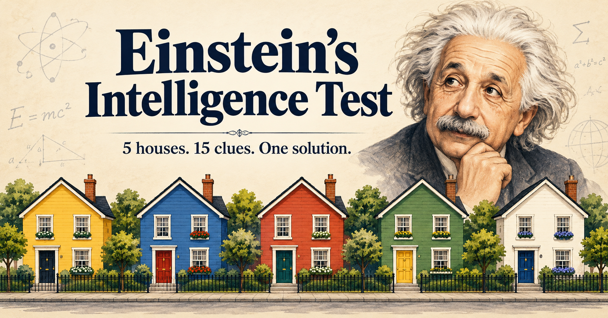

# Einstein's Intelligence Test
> [Albert Einstein]'s intelligence test

This is a `Java` app which serves as a game to test intelligence according to [Albert Einstein]. They say that only about 2% of people can solve this test, but the number is possibly much, much higher. The point of the game is to use the clues to deduce which owner lives in which house and what their basic characteristics are.



## Table of Contents

- [Run](#run)
- [Install on Windows](#install-on-windows)
- [Playing](#playing)
- [Validation](#validation)
- [Contributing](#contributing)
- [Security](#security)
- [Third-party software](#third-party-software)
- [License](#license)

---

## Landing page

The responsive, buildless website lives in [`site/`](site/). It includes game
instructions, a current desktop screenshot, Windows/JAR downloads, and installation
notes. To preview it, run `python3 -m http.server 8000 --directory site` and open
`http://localhost:8000`. Check download resolution and failure states with
`node --test test/site-downloads.test.cjs` (Node.js 18+). The landing-page workflow
runs these checks before deployment and on relevant pull requests.

In GitHub **Settings → Pages**, select **GitHub Actions** as the build source.
The [Landing page workflow](.github/workflows/pages.yml) deploys changes to `site/`
on `master`, or can be run manually. The expected address is
https://zlatanstajic.github.io/einstein-intelligence-test/.

The page resolves available packages from the latest GitHub Release. If no release
exists or the API is unavailable, it links to releases and CI builds instead of
presenting nonexistent files as downloads. Artifact downloads require GitHub sign-in.
The Build workflow publishes the verified JAR and Windows MSI when a `v*` tag is
pushed; ordinary pushes continue to produce CI artifacts. Publishing a release
requires both build jobs to succeed. No release or deployment is made by a local build.
The site uses relative asset paths so it works under the repository's Pages subpath.

## Run

Requires a Linux desktop, JDK 11 or newer, and `make`. The compiler targets Java 11;
local compilation was verified with JDK 18. The About links use the operating system’s browser and email handlers.

```bash
make run
```

| Command | What it does |
|---|---|
| `make build` | Compiles the app into `build/`. Skips compiling when no source file changed. |
| `make run` | Builds if needed, then starts the app. |
| `make test` | Runs headless gameplay, language and rank-list persistence tests. |
| `make test-ui` | Runs Swing integration checks on an accessible desktop. |
| `make jar` | Builds `dist/einstein-intelligence-test.jar` with classes, images and the SQLite driver. |
| `make check` | Runs headless tests and verifies the runnable JAR; used by CI. |
| `make install-hooks` | Installs the repository pre-commit hook locally. |
| `make clean` | Deletes generated `build/` and `dist/` output. |

Without `make`, run the same steps by hand from the project root:

```bash
javac --release 11 -encoding UTF-8 -d build src/com/zlatanstajic/einsteinintelligencetest/*.java
java -cp build:src:lib/sqlite-jdbc-3.50.3.0.jar com.zlatanstajic.einsteinintelligencetest.MainWindow
```

Keep `src` on the development runtime classpath so the application can load its images,
and `lib/sqlite-jdbc-3.50.3.0.jar` so it can store the rank list.
For a self-contained distribution, run `make jar`, then:

```bash
java -jar dist/einstein-intelligence-test.jar
```

The JAR includes its images and bundles the SQLite driver. It needs a graphical
desktop and Java 11 or newer, but not the checkout.

[⬆ back to top](#table-of-contents)

---

## Install on Windows

Each [Build workflow](.github/workflows/build.yml) run builds a Windows installer
after `make check` passes. jpackage from Temurin JDK 21 packages the runnable JAR
with its own Java runtime, so players do not need to install Java.

1. Open a successful Build workflow run on GitHub.
2. Download the `.msi` file from the run's artifacts.
3. Run the MSI. It installs for the current user and adds Start Menu and desktop shortcuts.
4. To uninstall, use **Settings → Apps**.

Tagged installers use the release version (for example, `v1.0.0` produces MSI
version `1.0.0`); branch builds use `1.0.<workflow run number>`. MSI upgrades require
a higher version. Uninstall older preview builds with a higher internal version
before installing `1.0.0`.

Installers are unsigned until the free SignPath Foundation enrollment is approved
and configured. Windows may show a SmartScreen warning. See
[Windows signing setup](docs/windows-signing.md) for the enrollment and CI settings.
On Windows, the rank list is stored in `%USERPROFILE%\.einstein-intelligence-test\winners.db`.
The About dialog opens websites and email through Windows’ registered URL handlers.
Email requires a configured email application. Linux uses `xdg-open`; macOS uses `open`.

[⬆ back to top](#table-of-contents)

---

## Playing

Press Start, then use the 15 clues to fill in the five houses. Check submits the
whole grid, with three attempts per game. Clue checkboxes only mark clues as used.
The timer starts at 00:00 when you press Start and stops when the game ends.
Pause freezes the timer and locks the game controls; Resume continues without
counting paused time. Restart clears the grid, restores all attempts, and resets the timer.

After a correct Check, the Solved dialog shows your time and asks for your name for
the rank list. A name has 1 to 40 characters after surrounding spaces are removed;
an invalid name is asked for again with your text kept. Save stores the result;
Cancel, Escape or closing the dialog stores nothing. The **Rank List** button in the
top bar lists every stored result, fastest time first, and the earlier date first
for equal times. Records are read-only: the app offers no way to edit or delete them.
They are stored in `~/.einstein-intelligence-test/winners.db`.

English is the default language. Use **Language → Serbian (Latin)** to switch to
Serbian; the menu then reads **Jezik**. Rank List, About and the right-aligned timer are also in the top bar.
The About dialog includes a website link below the author's email.
Changing the language preserves your answers, clue marks, attempts, and timer.

The interface uses a flat-styled, bundled Nimbus theme with no external UI libraries.
Five numbered house columns sit beside the scrollable clue list. Resize the window:
clues move below the houses on narrower screens, with scrolling for content that
needs more room. Checked clues move below unchecked clues and use teal highlights; unchecking restores their original order. Values chosen in one house are disabled in the other dropdowns of the same kind until changed or cleared. A `0/15` counter on the Clues heading line
shows how many clues are checked, updates as clues are marked or cleared, and resets for a new game. The footer shows game status and
remaining attempts in the selected language.

Keyboard shortcuts: **Alt+S** Start, **Alt+P** Pause/Resume, **Alt+R** Restart,
**Alt+C** or **Enter** Check, **F1** About, **Alt+L** Rank List, and **Esc** exit confirmation.
About and the Rank List also close with **Esc**. Disabled controls remain unavailable through shortcuts.

[⬆ back to top](#table-of-contents)

---

## Validation

Run `make check` for deterministic gameplay and translation tests plus runnable
JAR verification. Tests use the JDK and the committed SQLite driver, so they need
no downloads, and they fail through explicit assertions. Compilation uses `--release 11`; local checks ran on JDK 18.

The [Build workflow](.github/workflows/build.yml) runs `make check` on Linux with
Temurin JDK 11 for pushes and pull requests, then builds the
[Windows installer](#install-on-windows) from the verified JAR. `make test-ui` separately checks the
actual Swing controls on the event dispatch thread and requires an accessible
graphical display. It opens and disposes test windows; it is not a headless CI step.

Install the local [pre-commit hook](hooks/pre-commit) after cloning:

```bash
make install-hooks
```

This copies the repository hook to Git's active hooks directory with executable
permissions, replacing the local pre-commit hook. Re-run it after changing the
repository hook. Before each commit, it checks staged whitespace and runs
`make --always-make check` against the working tree, blocking the commit on failure.
The hook runs headless tests and JAR checks; desktop tests remain `make test-ui`.
It does not stage files or create commits.

`GameSession` owns gameplay rules and active elapsed time independently of Swing.
`MainWindow` owns rendering, control enablement, clue markings, and dialogs.
`WinnerStore` owns the rank list database, its ordering and the name rule;
`RankListDialog` shows the stored results read-only.
[Layout assessment](docs/layout-assessment.md) records the tested normal and enlarged
font/scaling settings, the new layout managers, and remaining platform limits.

[⬆ back to top](#table-of-contents)

---

## Contributing

See [CONTRIBUTING.md](CONTRIBUTING.md) for build, GUI editing, and verification
guidance. Participants must follow the [Code of Conduct](CODE_OF_CONDUCT.md).

[⬆ back to top](#table-of-contents)

---

## Security

Report vulnerabilities privately using [SECURITY.md](SECURITY.md).

[⬆ back to top](#table-of-contents)

---

## Third-party software

The rank list stores results with the SQLite JDBC driver, committed to the repository:

| Item | Value |
|---|---|
| Coordinates | `org.xerial:sqlite-jdbc:3.50.3.0` |
| Path | `lib/sqlite-jdbc-3.50.3.0.jar` |
| Source | [Maven Central](https://repo1.maven.org/maven2/org/xerial/sqlite-jdbc/3.50.3.0/) |
| SHA-256 | `a3f53a2aa15ae9425a9e793bbe9c8e5288febeb4b65ef5c1a4e80d4c2045cf08` |
| License | The Apache Software License, Version 2.0 |

Check the committed jar against the recorded digest:

```bash
sha256sum lib/sqlite-jdbc-3.50.3.0.jar
```

[⬆ back to top](#table-of-contents)

---

## License

This project is licensed under the [MIT License](LICENSE.md).

[⬆ back to top](#table-of-contents)

[Albert Einstein]: https://en.wikipedia.org/wiki/Albert_Einstein
